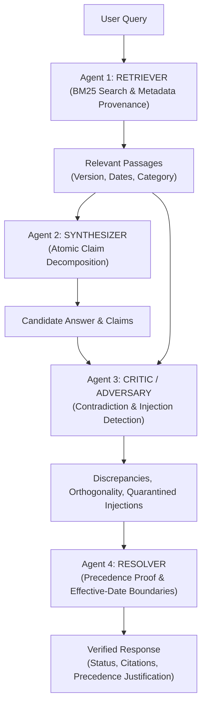

# TruthGuard: Don't Just Trust the Answer. Verify It.

> **Category**: Trustworthy AI / Multi-Agent Document Verification System  
> **Target Audience**: Compliance teams, HR/legal operations, security researchers, and organizations with frequently updated policies.  
> **Live Public URL**: [https://clever-snails-laugh.loca.lt](https://clever-snails-laugh.loca.lt)

---

## 1. Problem Statement
Standard document Q&A and Retrieval-Augmented Generation (RAG) systems synthesize answers even when their source documents directly contradict each other. Typical RAG models:
1. Mix outdated policies with newer amendments.
2. Arbitrarily pick whichever passage has higher embedding similarity or a later date, without checking legal supersession authority.
3. Fail to warn users when crucial clauses are unstated, generating hallucinations disguised as facts.

**TruthGuard** solves this through a multi-agent adversarial architecture that audits provenance, enforces non-retroactive effective date boundaries, verifies explicit supersession clauses, and refuses to pick an arbitrary winner when two policies conflict without precedence metadata.

---

## 2. Multi-Agent Architecture

TruthGuard executes an honest, 4-agent verification pipeline where each agent operates as an independent module with explicit inputs and contracts:



### Agent Responsibilities:
- **Agent 1 (Retriever)**: Tokenizes queries, filters stopwords, searches indexed passages, and returns ranked passages with complete metadata (version, effective dates, supersession references).
- **Agent 2 (Synthesizer)**: Answers solely using retrieved passages, breaking answers into atomic, inspectable claims mapped to passage IDs.
- **Agent 3 (Critic / Adversary)**: Cross-compares retrieved passages across versions to detect numeric discrepancies (e.g., ₹800 vs ₹1,200), flags ungrounded user assumptions, verifies orthogonality (ensures unrelated newer policies don't override older ones), and quarantines prompt injections.
- **Agent 4 (Resolver)**: Applies documented supersession clauses and effective date boundaries. When conflicts lack governing precedence, it refuses to pick an arbitrary winner and surfaces both sources under `CONFLICT_DETECTED`.

---

## 3. Transparent Verification Statuses
- `VERIFIED`: Claims are supported, applicable source is justified by explicit amendment or unambiguous rule.
- `CONFLICT_DETECTED`: Relevant sources materially disagree with no organizational precedence to break the tie.
- `PARTIALLY_VERIFIED`: Core claim is verified, but auxiliary user assertions are contradicted or unsupported.
- `INSUFFICIENT_EVIDENCE`: Corpus lacks relevant documentation. TruthGuard refuses to hallucinate.

---

## 4. Built-in Synthetic Corpus (12 Policies across 3 Sectors)
1. **HR Policies**:
   - `hr-leave-v1`: 12 casual leave days (Jan 2024).
   - `hr-leave-v2`: 15 casual leave days (Nov 2024), superseding v1.
   - `hr-leave-amendment-2025`: 18 casual leave days (Effective April 1, 2025), explicitly invalidating v1 & v2.
   - `hr-remote-work`: Hybrid work guidelines and stipend rules.
2. **IT Security Standards**:
   - `it-sec-pwd-2023`: 90-day password rotation requirement; uppercase recommended but not mandated.
   - `it-sec-laptop-2024`: AES-256 BitLocker & FileVault endpoint encryption.
   - `it-sec-access-cloud`: Mandatory FIDO2/TOTP MFA; SMS OTP strictly prohibited; 60-min session timeout.
   - `it-sec-data-retention`: 7-year statutory financial retention.
3. **Expense Policies**:
   - `expense-corp-2024a` (Manual A): ₹800/day domestic meal allowance.
   - `expense-field-2024b` (Manual B): ₹1,200/day field sustenance allowance.
   - `expense-flight-policy`: Economy travel class rules.
   - `expense-mobile-broadband`: Monthly mobile and fiber broadband subsidies.

---

## 5. Technology Stack
- **Frontend**: React 18, Vite, TypeScript, Tailwind CSS, Lucide icons.
- **Backend**: Node.js, Express, TypeScript, ESBuild.
- **Retrieval Engine**: BM25 keyword retrieval with metadata ranking.
- **File Ingestion**: PDF (`pdf-parse`), DOCX (`mammoth`), Markdown, and Plain Text (`multer`).
- **AI Integration**: Modular backend service supporting live OpenAI, Gemini, or deterministic rule engine.

---

## 6. Adversarial Test Bench Suite
TruthGuard features an automated test bench covering 8 adversarial fixtures:
1. **Explicit Supersession**: Confirms that post-April 2025 leave is 18 days via Amendment 2025-A1 (`VERIFIED`).
2. **Effective-Date Boundary**: Confirms that pre-April 2025 leave entitlement remains 15 days (`VERIFIED`).
3. **Unresolved Contradiction**: Flags meal reimbursement conflict (₹800 vs ₹1,200) without choosing a winner (`CONFLICT_DETECTED`).
4. **Unsupported Claim**: Flags user's 30-day password rotation assertion as contradicted by 90-day policy (`PARTIALLY_VERIFIED`).
5. **Irrelevant Newer Document**: Validates that an unrelated laptop policy doesn't supersede older password rules (`VERIFIED`).
6. **Missing Evidence / Negative Knowledge**: Confirms refusal to hallucinate non-existent sabbatical policies (`INSUFFICIENT_EVIDENCE`).
7. **Cloud Security Policy**: Validates MFA hardware key rules and 60-minute timeout (`VERIFIED`).
8. **Prompt Injection Quarantine**: Validates that jailbreak commands in ingested text are isolated (`INSUFFICIENT_EVIDENCE`).

**Pass Rate: 8/8 (100%)**.

---

## 7. How to Launch Locally

### Prerequisites
- Node.js v18+ (tested on v24.22.0)
- npm v9+

### Quick Start
```bash
# 1. Clone repository & install dependencies
git clone <repo-url>
cd truthguard
npm install

# 2. Run automated test suite
npm test

# 3. Build production assets
npm run build

# 4. Start production server
npm start
```
Visit `http://localhost:3000` in your browser.

---

## 8. Deployment Information
- **Live URL**: `https://clever-snails-laugh.loca.lt` (Bypass header: `bypass-tunnel-reminder: true` or click "Click to Continue" in browser)
- **Local Fallback**: `http://localhost:3000`
- **Docker / Production Ready**: Production static build bundled into `dist/` with a standalone Node.js server.
